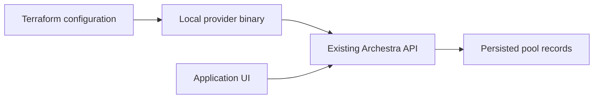

# Local model-pool acceptance

No provider publication or staging deployment is needed. Build the provider in
this checkout and use Terraform's `dev_overrides` through a private CLI config.
The harness uses a new local state directory and one uniquely named pool. All
members remain disabled and use dummy model names; it sends no inference requests.

Terraform manages the same pool records as the application UI. The provider
calls the existing pool CRUD API; request routing and failover stay in Archestra.



## Prepare without credentials

Use an existing owner-confirmed local API that exposes pool CRUD and has model
pools enabled. Do not restart another development stack to run this probe.
The `prepare` command reads only public health and OpenAPI endpoints and creates
new private files. Choose a workspace path that does not already exist.

```shell
GOMAXPROCS=1 GOFLAGS=-p=1 go build -o terraform-provider-archestra .
python3 scripts/integration/model-pool-lifecycle.py prepare \
  --api-url http://127.0.0.1:9000 \
  --provider-directory "$PWD" \
  --workspace /tmp/model-pool-proof
TF_CLI_CONFIG_FILE=/tmp/model-pool-proof/terraform.rc \
  terraform -chdir=/tmp/model-pool-proof validate
```

Review `main.tf.json`, `terraform.rc`, `manifest.json`, and `evidence.json`.
The manifest records the exact provider binary hash and the API's public
capabilities. OpenAPI availability does not establish that the feature flag or
management permissions are enabled. Preparation rejects the older pool-owned
grant write contract, which could otherwise clear grants during unrelated edits. There is no `terraform init` step: the local
development override selects the built provider without a registry download.
The Terraform API credential is supplied only when executing the next step.

## Execute in an approved disposable scope

Before running, confirm the stack owner, use of an existing management API
credential, use of one existing shared fixture provider-key UUID, and permission
to create/update/delete the single synthetic pool. This probe creates no keys or
security grants and edits no provider-key records. It refuses remote API origins,
redirects in its direct API probes, reused state, and extra Terraform files.

```shell
python3 scripts/integration/model-pool-lifecycle.py run \
  --workspace /tmp/model-pool-proof \
  --key-file /path/to/existing-test-api-key \
  --provider-key-id 22222222-2222-4222-8222-222222222222
```

Replace the path and UUID with the approved existing test inputs. The key file is
read only at execution; its value is passed through `ARCHESTRA_API_KEY` and is
not included in HCL or evidence. Add `--ui-checkpoints` when an operator is ready to capture the actual local UI.
The harness pauses after create/update and records the pool UUID and name before
continuing. The harness waits until the operator presses Enter; it does not
verify UI availability or capture screenshots itself.
This command performs the following operations:

1. Confirm the generated pool name is unused through an authenticated list.
2. Create one pool with two disabled members referencing the same fixture key.
3. Verify a no-change refresh, update its name/weight, and retain its UUID.
   Record fresh API snapshots of the name, priorities, weights and disabled flags.
4. Remove only the local state binding, import that UUID, and verify a no-change plan.
5. Change only that pool through its API, require a single in-place Terraform
   update in the drift plan, apply the saved plan, and verify convergence.
6. Destroy the pool and confirm its UUID is absent from a successful API list.

Cleanup runs on failures too. A create with an uncertain outcome and no visible
pool is reported as blocked, since an in-flight server write may still commit. If Terraform loses the create response or import
binding, cleanup can delete only a matching synthetic pool with the expected
generated name prefix, upstream model IDs, provider reference, disabled flags and no grants. If ownership
changes or cleanup cannot be verified, the harness reports a blocked cleanup and
retains the workspace and any recorded pool identity for operator review. Do not discard its
state or rerun it as a fresh success; inspect `evidence.json` and private logs.

## What this proves

A completed run proves real API persistence and the native Terraform provider's
create/read/update/import/drift/destroy path for the recorded binary and API.
It does not prove live inference routing, grant changes, or Crossplane
reconciliation. Current pool writes own name and members; grants belong to
credential configuration and are read-only on the pool resource.

For credential-free checks, run focused provider tests with one worker and the
harness tests:

```shell
GOMAXPROCS=1 GOFLAGS=-p=1 go test -parallel=1 -run TestModelPool ./internal/provider
python3 -m unittest discover -s scripts -p test_model_pool_lifecycle.py
```

Crossplane schema generation, builds, and configuration/reference tests run
locally without installing it. Live reconciliation needs a cluster with
Crossplane plus the generated CRDs and a local controller using the same local
Terraform build. Confirm that installation exists before proposing a probe;
creating a new cluster or installing Crossplane is a separate setup operation.
