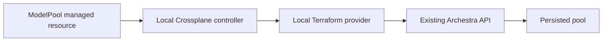

# Local Crossplane model-pool proof

This tests the Kubernetes-controller route in addition to the
[native Terraform proof](model-pool-local-acceptance.md). No staging deployment,
provider publication or container build is required. The existing development
recipe runs the real generated controller on the host and selects the local
Terraform provider through a filesystem mirror.



## Scope and prerequisites

Use an owner-confirmed local kind cluster and an existing loopback Archestra API
with model pools enabled and the credential-owned grant contract. Obtain scoped
permission for the Crossplane installation/CRDs, a temporary management key and
Secret, and sequential disabled synthetic pools. The key inherits its caller's
available management permissions; it is not an inference provider key.

Reuse one existing organization-owned fixture provider-key UUID. The local mode
wraps it in an Observe-only ModelProvider: it creates no upstream provider keys,
agents, OAuth clients or grants. Both dummy pool members stay disabled. Run one
controller worker and preserve unrelated cluster workloads and pools.

Prepare a private work directory and a dedicated kubeconfig from the selected
kind cluster. Never change the user's current context. Record the pre-run CRD,
namespace and deployment identities, and fingerprint existing pool settings.
Keep credentials out of logs and committed files.

## Prepare the real runtime

1. Build the native provider, run `make -C crossplane generate`, then build
   `crossplane/cmd/provider` for the host with `GOMAXPROCS=1 GOFLAGS=-p=1`.
   Existing matching binaries can be reused; record their SHA-256 hashes.
2. Install the official pinned chart in a new task-owned namespace:

   ```shell
   helm install pool-proof crossplane \
     --repo https://charts.crossplane.io/stable --version 2.2.1 \
     --namespace pool-proof --create-namespace \
     --set rbacManager.deploy=false \
     --set rbacManager.skipAggregatedClusterRoles=true --wait --timeout 5m
   ```

   The host controller uses existing local cluster access, so this proof does
   not need the optional RBAC-manager pod or aggregated roles. Core chart
   security settings remain at their defaults.
3. Apply only nine generated provider CRDs from `crossplane/package/crds/`:
   the five ProviderConfig/ProviderConfigUsage schemas, plus ModelPool and
   ModelProvider in each scope. Wait for Established. Do not overwrite an
   existing installation or force ownership conflicts.
4. Create one owned Secret containing credentials JSON with `api_key`,
   `base_url: "http://localhost:9000"` and the tested `api_version_constraint`.
   Use a mode-0600 private input file and `kubectl create secret --from-file`,
   then remove that input file. Never use the key value as a command argument.
   Create a cluster ProviderConfig and a ClusterProviderConfig referring to
   that Secret, both named `pool-proof`. The latter serves namespaced resources.
   See the [configuration shape](https://github.com/archestra-ai/terraform-provider-archestra/tree/main/crossplane/examples).
5. Mirror the local provider under
   `registry.terraform.io/archestra-ai/archestra/3.0.4/<host-platform>/` and select
   it with a private `TF_CLI_CONFIG_FILE`. Use Terraform 1.5.7, matching the
   existing [development recipe](https://github.com/archestra-ai/terraform-provider-archestra/blob/main/scripts/bootstrap-crossplane.sh).
   That recipe also shows the mirror layout. Read it before reuse: its stock
   entry point assumes its own app stack and credential bootstrap, installs
   every provider CRD, and can deploy an unrelated MCP fixture. Those steps are
   unnecessary for this focused proof.
6. From the private work directory, launch the already-built controller with
   the private kubeconfig, Terraform 1.5.7 on PATH, and the mirror CLI config:

   ```shell
   /path/to/local/controller \
     --terraform-version=1.5.7 \
     --terraform-provider-source=archestra-ai/archestra \
     --terraform-provider-version=3.0.4 \
     --poll=2s --max-reconcile-rate=1 \
     --metrics-bind-address=127.0.0.1:18080 --certs-dir=
   ```

   Record its PID and private log. Confirm port ownership before launch. The
   host controller reaches localhost9000 directly. A provider running in a pod
   must instead use an endpoint reachable from that pod; localhost refers to
   the pod itself. Node reachability does not establish pod networking.

## Execute the bounded probe

From the repository root, using approved existing input paths and UUID:

```shell
python3 scripts/integration/crossplane-lifecycle.py \
  --api-url http://localhost:9000 --key-file /private/path/management-key \
  --llm-base-url http://127.0.0.1:8981/openai/v1 \
  --cases model-pools --pool-resource-only \
  --existing-provider-key-id 22222222-2222-4222-8222-222222222222 \
  --scopes cluster namespaced --kubeconfig /private/path/kubeconfig \
  --provider-config pool-proof --namespace pool-proof \
  --terraform-binary ./terraform-provider-archestra \
  --controller-binary /path/to/local/controller \
  --evidence /private/path/model-pool-crossplane.json
```

The required LLM URL is a loopback fixture placeholder in this mode; no inference
is invoked. The probe creates one synthetic pool at a time, resolves its existing
provider reference, and checks Ready/Synced plus actual API persistence. It updates
name/weight, verifies that an out-of-band PUT really introduced drift, and waits
for automatic repair. It then orphans and adopts the same UUID through
`crossplane.io/external-name` before normal controller deletion. This is
Crossplane adoption, rather than a separate `terraform import` command.

Without `--pool-resource-only`, the existing `model-pools` CI case also creates
its own fixture provider keys and tests agent/OAuth bindings. Do not run that
broader mode against a shared local stack under the pool-only approval.

## Cleanup and recorded result

Cleanup runs on probe failures. An orphan's API fallback stays tracked until
adoption and deletion are verified; owning CRs must be removed before a fallback
API delete so a live controller cannot recreate an orphan. If cleanup fails,
retain the evidence and diagnose the recorded objects; do not remove finalizers.

After the probe, independently confirm synthetic UUIDs are absent and pre-existing
pool fingerprints match. Remove owned ProviderConfigs while the controller can
release usage finalizers, then remove the Secret. Revoke the exact temporary key
through the supported account API/UI and verify lookup returns 404 and the revoked
key no longer authenticates. Delete its private key/cookie files afterward.
Stop only the recorded controller, uninstall only the task-owned chart, and remove
only empty provider CRDs and the namespace created for this proof. Chart removal
can retain official core CRDs: inventory and report them rather than deleting
shared API definitions blindly. Preserve evidence and unrelated services.

The [recorded local proof](https://github.com/archestra-ai/terraform-provider-archestra/blob/main/audit/model-pool-local-crossplane-rc11.json)
passed in both scopes against a development API reporting `1.5.0-rc.11`, with
Crossplane 2.2.1 and Kubernetes v1.37.0. Both members remained disabled; priorities
were 1/2, the first weight changed 3 to 7, injected drift used weight 11, and repair
restored 7. Update/adoption retained each pool UUID. Both original pools were
unchanged and the temporary key returned 401 after revocation. Task processes,
Secret/configs, namespace and nine provider CRDs were removed; 21 official core
Crossplane CRDs remained, with no task deployment running. The user's app/backend
and original cluster objects were preserved.

This establishes real local controller reconciliation. It does not measure
inference distribution/failover, mutate grants, test container/xpkg deployment,
or establish release compatibility across versions.
